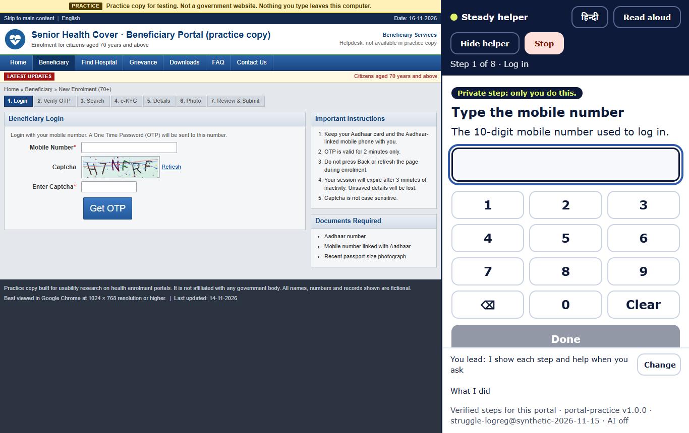
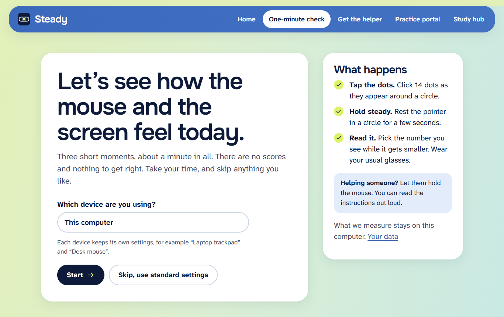
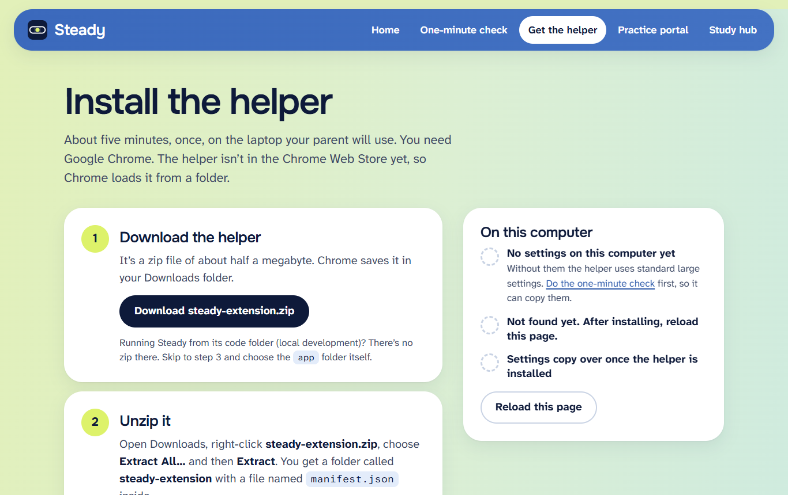
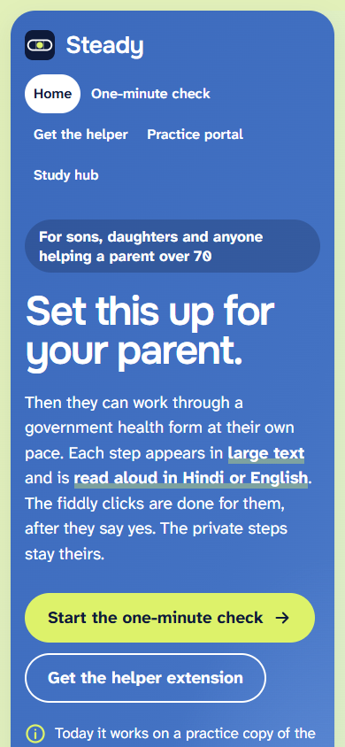

# Steady: government health forms, steadied for older hands and eyes

**Live demo:** https://steady-helper-alpha.vercel.app · **Practice portal:** https://steady-helper-alpha.vercel.app/portal/

Steady is a free Chrome helper that guides older people, first of all people living with Parkinson’s, through government health forms. Each step appears in large text, read aloud in Hindi or English. The helper does the safe steps after a yes, and the private steps stay with the person.



## The problem

Every citizen aged 70+ is eligible for ₹5 lakh a year of free hospital cover, but about **1.36 crore of roughly 6 crore** had the card in September 2026 (PIB). The enrolment apps assume a young, literate user with steady hands and their own Aadhaar-linked phone. App-store reviews describe:

- captchas older people can't read ("the many many Captcha got my eyes red and paining"),
- OTPs that go to a son's phone,
- sessions that wipe everything after a timeout.

Evidence and sources: [`docs/research/`](docs/research/).

## How it works

| Phase | What | Where |
|---|---|---|
| 1. Website | A one-minute check measures tap accuracy, hand steadiness (tremor) and the smallest readable text. It sets button size, text size and how much the helper offers to do. | `app/index.html`, `app/calibrate.html` |
| 2. Extension | The helper agent. On a portal with verified steps it walks through them. On any other site, click the Steady icon: it enlarges fields on demand and can guide step by step with AI. | `app/js/agent*.js`, `app/manifest.json` |
| 3. App | The same engine on the elder's own phone. | planned |

**The AI, and what it is allowed to do**

- **Ability profile** (on the device, explainable): a Bayesian tap-scatter estimate, tremor amplitude and frequency, and a reading threshold. A policy tree turns these into sizes and a starting help level.
- **Struggle detector** (on the device): a logistic model over missed taps, double presses, corrections, errors, zooming and long pauses. Together with a live tremor estimate, it decides when to *offer* more help; more help always needs a yes.
  - Today's weights come from synthetic sessions (`tools/train-struggle.mjs`), not user data. Retrain with `--data pilot.csv`.
- **Planner:** verified playbooks first (`app/js/flowmap-portal.js`). On unfamiliar pages, Claude proposes one next action at a time from a **masked** page: labels and whether each field is filled, never values or numbers.
- **Guardrails** (`app/js/agent-core.js`): the AI can press Next or choose from a list. It can never fill Aadhaar, OTP or captcha, tick consent, or press Submit. Those always go to the person, on a large keypad.

The panel footer says which "brain" is active: verified steps, the AI planner, or on-device help only. Every AI step is marked ✦ in the helper's log.

| One-minute check | Install | On a phone |
|---|---|---|
|  |  |  |

## Privacy

- No servers of ours. The one-minute check stays in the browser.
- Saved answers (practice portal only) are AES-GCM encrypted on the device and deleted after the application, or after 7 days. Aadhaar is kept only if the person agrees.
- The optional AI fallback sends only a masked page description, and only if an API key is added in the extension's Options.
- On other websites the helper attaches only to the tab you click, and stores nothing.

## Try it

1. Open the [live site](https://steady-helper-alpha.vercel.app) and do the one-minute check.
2. Install the helper: download the zip from the [install page](https://steady-helper-alpha.vercel.app/get.html), unzip it, then go to `chrome://extensions`, turn on Developer mode and click **Load unpacked**. In a clone of this repo you can load the `app/` folder directly.
3. Open the [practice portal](https://steady-helper-alpha.vercel.app/portal/). The helper panel opens on the right. On any other website, click the Steady icon.

### Run locally

```bash
python -m http.server 8080 -d app      # then open http://localhost:8080
```

### Deploy (free, Vercel Hobby)

```bash
node tools/build-web.mjs                # → dist/web (SEO tokens filled, vercel.json headers, extension zip)
cd dist/web && vercel link --yes --project steady-helper && vercel deploy --prod --yes
```

Set `SITE_URL` before building to change the public origin used in canonical URLs, the sitemap and link previews.

### Tests

```bash
node --test tests/core.test.js tests/agent-core.test.js
PLAYWRIGHT_PATH=<path-to-playwright> node tests/portal.smoke.e2e.js
```

## Status (honest)

- **Works fully** on a practice copy of a 70+ enrolment portal (`app/portal/`), which is labelled and not affiliated with any government.
- **Works in a lighter mode** on any website.
- **Not yet** on the real portals: each needs a verified adapter, and testing past login needs a real Aadhaar.
- The struggle model is trained on synthetic data until the pilot (target: 3+ people with Parkinson's, plus 5–8 other older adults, on the mock flow only).
- The browser end-to-end walkthrough of the agent has not been automated yet.

Build contracts: [`docs/build/phase-1-2-contracts.md`](docs/build/phase-1-2-contracts.md). Design and research write-up: `Implementation.md`, `plan.md`.
